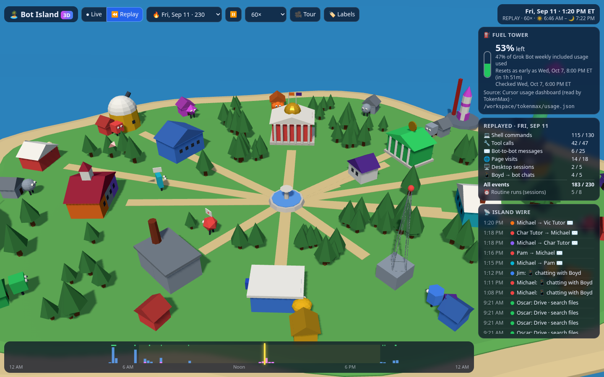
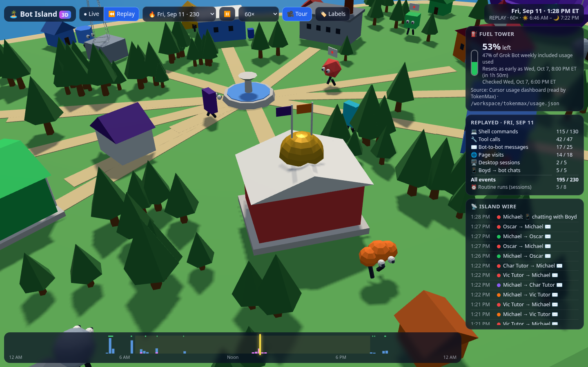
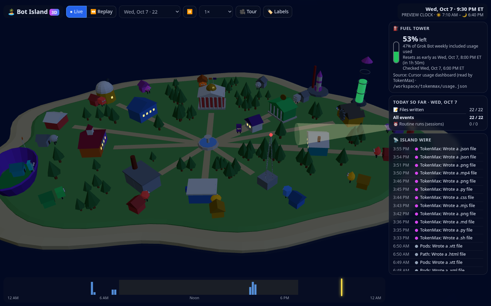
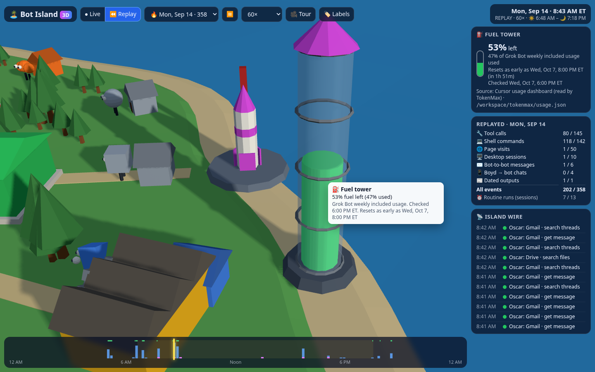
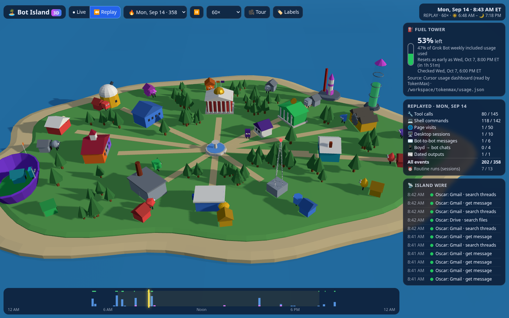

# 🏝️ Bot Island 3D

A Three.js remake of [Bot Island](../bot-island/README.md), the live map of Boyd's Grok Bot fleet. It's built from Bot Island's
**existing data files, read-only**, and nothing in `../bot-island` is modified.

* **Open:** http://127.0.0.1:4261/. Port 4259 was already taken by *Fleet Doctor* (`../fleet-doctor`, started 6:02 PM ET), so `run.sh` falls back to 4261. If 4259 is free when you run it, it uses 4259.
* **Offline:** `dist/bot-island-3d.html` (1.3 MB, single file: three.js r169 + app + data, no network). Double-click to open it anywhere.
* **Best screenshot:** `screenshots/00-best-sep11-messages.png`



| Auto-tour following the messages | Tonight 9:30 PM ET (lit windows, lighthouse beam, everyone home) |
|---|---|
|  |  |
| **Fuel tower** (reads `usage.json`) with hover label | **Sep 14 morning rush** (Oscar → Michael, Brief's calendar run) |
|  |  |

## What's on the island
* **Low-poly island.** Same outline formula and building layout as Bot Island (parsed from its `web/app.js`). It has flat-shaded terrain, a sand rim, animated water and decorative trees.
* **Each bot's building is in its Bot Island color.** Colors come from the profile `color` plus Bot Island's palette. Shared buildings are striped with each resident's color. For example, the Schoolhouse is Char Tutor violet, Vic Tutor orange and Path gray.
  * 🏛️ HQ (Michael red, Orioles and Ravens flags)
  * 📚 Library (Jim blue)
  * 🔭 Observatory (Kelly yellow)
  * 🏦 Bank (Oscar green)
  * 🏡 Clubhouse (Pam cyan)
  * 🏫 Schoolhouse
  * 📰 Press
  * 📻 Radio Tower
  * 📮 Post Office (Brief blue)
  * 🛠️ Workshop (Dwight yellow, gear spins faster when he's working)
  * 🥚 Hatchery (one egg per unhatched bot)
  * 💡 Lighthouse (Ryan red, beam sweeps at night)
  * 🚀 Launch Pad (TokenMax magenta)
  * 🏟️ Purple Stadium
  * ⛲ Town Square
  * Boyd's Place
  * Every bot also has a house on the rim, alphabetical like the 2D map.
* **Bot avatars** use each bot's real avatar shape (Jim's hex, Pam's tablet, TokenMax's sparkle, Michael's blob…) and color. Boyd is a purple #8.
  * **When a bot-to-bot message happens** (`agent_msg`), the sender walks from where it is to the recipient's building carrying an envelope, waits 2.5 minutes, and walks back. A paper airplane also flies the route.
  * **When Boyd messages a bot** (`boyd_msg`), Boyd walks over to that bot.
  * **Work sessions** are clusters of a bot's real tool, shell, browser and file events (6-minute gap, same rule as 2D) plus its routine runs from `runs.json`. During a session the bot stands at its workplace with a glowing ring.
  * **Otherwise bots stay home,** and they sleep (z z) from 10 PM to 6 AM. There is **no invented wandering**: every movement comes from a real event or run.
* **Day/night from the real ET clock.** The sun's position is computed for Baltimore (39.29°N, 76.61°W) from the time on screen: the real clock in Live mode, and the replayed clock in Replay. That gives real sunrise and sunset, dusk colors, stars, a moon, lit windows and the lighthouse beam.
* **Camera.** Orbit by dragging, zoom with the scroll wheel, and pan with right-drag. **🎥 Tour** (`t`) glides between buildings, jumps to wherever the latest message went, and stops when you click.
* **Replay scrubber.** Pick any of the 49 logged days (🔥 marks the 6 busiest). Sep 11 is the default: Michael coordinates the tutors, Oscar, Jim and Kelly between 1:15 and 1:41 PM.
  * Speeds are 60×, 5 min/s and 30 min/s.
  * The timeline histogram shows events per 10 minutes: blue for tools, pink for messages, green ticks for routine runs, and a yellow band for daylight. Drag it to scrub.
  * The **Replayed** card counts every event type as `fired / total for the day`.
  * The **Island wire** lists each event as it fires.
* **Labels on hover** for buildings (who works there and who's busy), houses, bots (what they're doing right now, events so far), Boyd and the fuel tower. **🏷️ Labels** (`l`) pins all of them.
* **⛽ Fuel tower.** It reads `/workspace/tokenmax/usage.json`, and the glass column fills to `100 − used_pct`.
  * It currently shows **53% left (47% used)**, checked 6:00 PM ET.
  * Resets are shown "as early as" 00:00 UTC on `reset_date` (8:00 PM ET Oct 7), the same rule Bot Island uses, with a countdown.
  * When served by `server.py`, the page re-reads `usage.json` every 60 seconds through `/api/usage`.

## Data, read-only
| File | Used for |
|---|---|
| `../bot-island/data/fleet.json` (3,960 events, 16 bots, generated Oct 7 3:55 PM ET) | events, bots, routine runs, avatar shapes and colors |
| `../bot-island/config.json` | hidden bots, usage file path |
| `../bot-island/web/app.js` | building layout, palette, emoji (parsed with regex, never executed) |
| `/workspace/tokenmax/usage.json` | fuel tower |

`islanddata.py` opens these files read-only and copies the event fields as they are (`ts, type, bot, from, app, tool, host, ext, approx, status`). No message content exists in the source, and none is shown. `python3 build.py` re-reads the files, so rebuilding picks up a newer `fleet.json`.

## Run
```bash
./run.sh           # build → serve (nohup, nice 10) → smoke test (one niced headless Chrome)
./run.sh --quick   # build + serve only
./run.sh --shots   # also re-render screenshots
```
URL options: `?mode=replay&day=2026-09-11&hour=13.3&speed=60`, `&play=0`, `&tour=1`, `&labels=1`, `&lite=1` (no shadows), `?at=2026-10-07T21:30:00-04:00` (preview the live clock at another time; it's labelled PREVIEW CLOCK).

## Tests: `python3 tests/smoke_test.py` (28 checks)
* Expected counts are computed **in Python straight from `../bot-island/data/fleet.json`** using `zoneinfo` ET days, independently of the JS.
* Headless Chrome (SwiftShader WebGL) then **replays four whole days through the real playback path**: Sep 11 (230 events), Sep 14 (358), Aug 20 (402) and Oct 6 (16). Every event type's fired count must equal the source, all via playback.
* It also checks:
  * scrubbing (events so far at 6 AM, 1 PM and 5 PM)
  * a real message (Pam → Michael at 7:58 AM Sep 11: Pam must be walking with the envelope)
  * the fuel-tower hover label and its level against `usage.json`
  * the camera moving in auto-tour
  * live mode on today's ET date with today's real events
  * 11:30 PM being night and 1 PM being day
  * that the snapshot embeds exactly the source events and is offline
  * that the server answers
  * **zero page errors**

## Known gaps
* The box's detailed logs stop on **Sep 16** (restore on Oct 3), so Live mode today mostly shows file writes. Replay is richest from Aug 20 to Sep 16, as the 2D README notes.
* Event *placement* (session clusters, walking speed, the 2.5-minute dwell) is a visualization rule. The events and timestamps themselves are real.
* The `fleet.json` snapshot is from 3:55 PM ET. Rebuild (`./run.sh`) after Bot Island re-collects.

## Files
`islanddata.py` (read-only extractor), `build.py`, `server.py`, `run.sh`, `src/` (index.html, style.css, app.js), `vendor/three/` (three.js r169 + OrbitControls + MIT LICENSE, copied from `../chopsticks/node_modules/three`), `vendor/three.iife.min.js` (bundled once with esbuild), `dist/`, `tests/` (cdp.mjs, render.mjs, screens.mjs, smoke_test.py), `screenshots/`.


---
## Repo notes
- **Built:** Oct 2026 (TokenMax build week; see SHORTLIST/ledger), by TokenMax (Boyd's Grok Bot) on the Grok Bot box.
- **Run:** `./run.sh` (then open the localhost URL it prints).
- Imported from `/workspace/tokenmax/bot-island-3d` on Oct 23, 2026. node_modules, virtualenvs, logs and files over 20 MB were left out.
